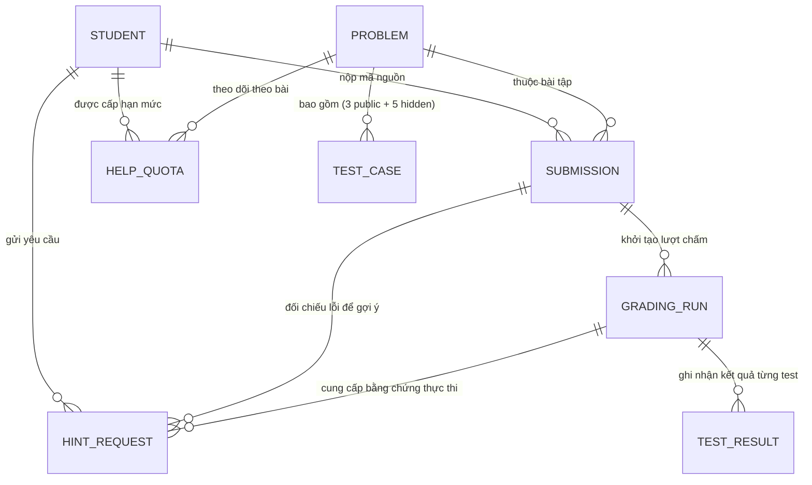

<div align="center">

# 🧠 Hệ Thống Chấm Bài Tập Lập Trình Tự Động & Quản Lý Hạn Mức Gợi Ý Sư Phạm
### Automated Code Grading, Quota Transaction Engine & Two-Tier Pedagogical Feedback Platform

-4169E1?logo=postgresql&logoColor=white)
-181717)


-2496ED?logo=docker&logoColor=white)

*Hệ thống phần mềm quản lý chấm bài lập trình tự động và cấp phát gợi ý sư phạm có kiểm soát hạn mức: chuẩn hóa lược đồ CSDL PostgreSQL 8 bảng (3NF), chống xung đột giao dịch đồng thời bằng Partial Unique Index, đặc tả đầy đủ 6 Use Cases nghiệp vụ (UC01–UC06) và đóng gói triển khai bằng Docker Compose.*

[🎯 Tổng quan Nghiệp vụ](#-tổng-quan-nghiệp-vụ--trạng-thái-hệ-thống) •
[💼 Điểm nhấn CSDL, BA & Triển khai](#-điểm-nhấn-năng-lực-thiết-kế-csdl-sql--phân-tích-nghiệp-vụ-ba--triển-khai) •
[🗄️ Thiết kế CSDL PostgreSQL (8 Bảng)](#-thiết-kế-csdl-quan-hệ-postgresql-8-bảng--kiểm-soát-đồng-thời) •
[🏗️ Kiến trúc Hệ thống](#️-kiến-trúc-tổng-thể) •
[🚀 Hướng dẫn Triển khai Docker](#-2-chạy-bằng-docker-compose-postgresql--pytest--api--worker)

</div>

---

## 🎯 Tổng Quan Nghiệp Vụ & Trạng Thái Hệ Thống

Ứng dụng **FastAPI + PostgreSQL** hỗ trợ sinh viên luyện tập lập trình Python theo quy trình nghiệp vụ khép kín: xem đề bài, nộp mã nguồn, chấm từng ca kiểm thử trong môi trường cô lập **Judge0**, và chủ động yêu cầu gợi ý sư phạm theo hai cấp độ **KM (Knowledge about Mistakes)** và **KH (Knowledge about How to Proceed)** từ mô hình ngôn ngữ lớn (LLM) có kiểm duyệt đầu ra (**Output Guardrail**) cùng cơ chế quản lý hạn mức giao dịch chặt chẽ (**tối đa 3 lượt/bài, thời gian chờ cooldown 120 giây**).

- **20 bài tập Python chuẩn hóa (`P01`–`P20`)**: mỗi bài gồm 3 ca kiểm thử công khai + 5 ca kiểm thử ẩn (tổng **160 test cases**), kèm lời giải tham chiếu (`reference_code`) và các mẫu mã sai đối chứng (`wrong_samples`).
- **Chuỗi Migrations PostgreSQL (`0001` → `0002` → `0003`)**: thiết kế đầy đủ **8 bảng quan hệ** (`student`, `problem`, `test_case`, `submission`, `grading_run`, `test_result`, `help_quota`, `hint_request`) kèm **Partial Unique Index** chống xung đột xử lý đồng thời.
- **Luồng chấm Judge0 & Harness an toàn**: tách biệt thực thi mã không tin cậy với máy chủ nghiệp vụ FastAPI; chống giả mạo kết quả JSON trên `stdout` bằng khóa `nonce` ngẫu nhiên.
- **Module Quản lý Giao dịch Hạn mức & Phản hồi Sư phạm (`HintOrchestrationService`)**:
  - **Adapter Pattern (`LLMServiceInterface`)**: hỗ trợ chuyển đổi linh hoạt giữa `APIDemoAdapter`, `ColabQwenAdapter` và `FakeLLMAdapter` (phục vụ kiểm thử tự động offline).
  - **Output Guardrail**: kiểm duyệt kết quả sinh tự động (lọc khối mã lộ đáp án, kiểm tra độ trùng lặp token `Token Overlap`), tự động thử lại tối đa `N=2` lần (`HINT_MAX_RETRIES=2`).
  - **Quy tắc Nghiệp vụ Hạn mức (Quota & Cooldown Transaction)**: tối đa 3 lượt thành công/sinh viên/bài (lần 1 cấp `KM`, lần 2–3 cấp `KH`), thời gian chờ `120s` giữa hai lần yêu cầu; nộp bài mới không làm mất quota cũ; **nếu hệ thống AI lỗi hoặc vi phạm Guardrail thì tự động hoàn tác, tuyệt đối không trừ lượt của sinh viên**.
- **Khung Đánh giá Thực nghiệm & Xuất Báo cáo (`Benchmark M1–M5`)**: xuất nhật ký `.jsonl`, bảng chấm Rubric `R1–R5` định dạng `.csv` và tự động tổng hợp bộ chỉ số đánh giá `M1–M5`.
- **Tài liệu kỹ thuật đầy đủ**: xem tại [`docs/references.md`](docs/references.md), hướng dẫn kiến trúc tại [`docs/implementation-guide.md`](docs/implementation-guide.md), kết quả kiểm chứng tại [`docs/verification.md`](docs/verification.md) và các quyết định thiết kế tại [`docs/open-decisions.md`](docs/open-decisions.md).

---

## 💼 Điểm Nhấn Năng Lực: Thiết Kế CSDL (SQL) • Phân Tích Nghiệp Vụ (BA) • Triển Khai

| Góc Nhìn Đánh Giá | Giải Pháp Kỹ Thuật & Nghiệp Vụ Đã Triển Khai Trong Dự Án |
| :--- | :--- |
| **🗄️ Thiết Kế CSDL & Lập Trình SQL**<br>*(PostgreSQL & Alembic)* | • **Chuẩn hóa Lược đồ 8 Bảng Quan hệ (3NF):** Phân tách rõ ràng dữ liệu danh mục (`student`, `problem`, `test_case`), dữ liệu giao dịch chấm bài (`submission`, `grading_run`, `test_result`) và dữ liệu quản lý hạn mức (`help_quota`, `hint_request`).<br>• **Kiểm soát Đồng thời bằng Partial Unique Index:** Ngăn chặn triệt để lỗi Race Condition khi người dùng bấm gửi nhiều yêu cầu liên tiếp cùng lúc cho một bài tập, đảm bảo tại một thời điểm chỉ có duy nhất một yêu cầu ở trạng thái đang xử lý.<br>• **Kiểm thử Chu trình Migration (`upgrade → downgrade → upgrade`):** Container `test` tự động kiểm chứng tính toàn vẹn hai chiều của toàn bộ chuỗi migration Alembic trước khi chạy bộ kiểm thử tích hợp PostgreSQL. |
| **📋 Phân Tích Nghiệp Vụ**<br>*(Business Analysis - BA)* | • **Đặc tả Đầy đủ 6 Use Cases (`UC01–UC06`):** Mô hình hóa rõ ràng luồng tương tác từ Tra cứu danh mục bài tập (`UC01`), Xem chi tiết & ca kiểm thử mẫu (`UC02`), Nộp bài & xếp hàng đợi chấm (`UC03`), Đối chiếu kết quả kiểm thử (`UC04`), Yêu cầu hỗ trợ theo hạn mức (`UC05`) đến Tra cứu lịch sử tổng hợp (`UC06`).<br>• **Thiết kế Quy tắc Nghiệp vụ (Business Rules Validation):** Định nghĩa chặt chẽ điều kiện tiên quyết để yêu cầu gợi ý (bài nộp phải có lượt chấm hoàn tất nhưng chưa đạt 100% test, còn hạn mức $< 3$, đã qua thời gian chờ `120s`), tách biệt thông tin ca kiểm thử công khai và ca kiểm thử ẩn (`HintContextV1`) để bảo mật ngân hàng đề. |
| **🚀 Triển Khai & Kiểm Thử Hệ Thống**<br>*(Implementation & QA)* | • **Đóng gói 4 Dịch vụ bằng Docker Compose:** Triển khai đồng bộ cơ sở dữ liệu `db` (PostgreSQL 17), máy chủ ứng dụng `api` (FastAPI + Web UI), tiến trình nền `worker` (Judge0 Polling) và môi trường kiểm thử `test`.<br>• **Chế độ Vận hành Linh hoạt & Chịu lỗi:** Cho phép chuyển đổi cấu hình qua tệp `.env` (`api_demo`, `colab_qwen`, `fake`, `disabled`), hỗ trợ chạy thử nghiệm và nghiệm thu toàn bộ luồng nghiệp vụ giao diện ngay cả khi ngoại tuyến (`LLM_MODE=fake`). |

---

## 🗄️ Thiết Kế CSDL Quan Hệ PostgreSQL (8 Bảng) & Kiểm Soát Đồng Thời



### Bảng Đặc Tả Lược Đồ 8 Bảng CSDL (`app/models/` & `alembic/versions/`)

| STT | Tên Bảng (`PostgreSQL`) | Khóa Chính / Khóa Ngoại & Chỉ Mục | Vai Trò Trong Nghiệp Vụ Hệ Thống |
| :---: | :--- | :--- | :--- |
| **1** | `student` | `PK: id` • `UNIQUE: student_code` | Lưu thông tin định danh sinh viên thực hiện bài tập. |
| **2** | `problem` | `PK: id` • `UNIQUE: slug` | Lưu đề bài, mô tả hàm yêu cầu, lời giải chuẩn (`reference_code`) và trạng thái công bố. |
| **3** | `test_case` | `PK: id` • `FK: problem_id` | Lưu 160 ca kiểm thử đầu vào/đầu ra chuẩn, phân loại `is_public` (công khai) hoặc ẩn. |
| **4** | `submission` | `PK: id` • `FK: student_id, problem_id` | Lưu bản chụp (snapshot) mã nguồn mỗi lần sinh viên nộp bài kèm thời điểm nộp. |
| **5** | `grading_run` | `PK: id` • `FK: submission_id` | Quản lý trạng thái tiến trình chấm (`queued`, `running`, `completed`, `failed`) và điểm số tổng hợp. |
| **6** | `test_result` | `PK: id` • `FK: grading_run_id, test_case_id` | Lưu chi tiết kết quả thực thi từng test case (thời gian chạy, bộ nhớ, thông báo lỗi/ngoại lệ). |
| **7** | `help_quota` | `PK: id` • `UNIQUE: (student_id, problem_id)` | Quản lý số lượt gợi ý đã sử dụng (`used_count <= 3`) và mốc thời gian kích hoạt `cooldown_until`. |
| **8** | `hint_request` | `PK: id` • `FK: student_id, problem_id, submission_id, grading_run_id` • `Partial Unique Index` | Lưu lịch sử yêu cầu gợi ý, cấp độ (`KM`/`KH`), trạng thái kiểm duyệt Guardrail và nội dung phản hồi. |

---

## 🏗️ Kiến Trúc Tổng Thể

```text
Trình duyệt / API client
        │
        ▼
FastAPI (UC01–UC06) ──────────────────────► PostgreSQL ứng dụng
  │                  │                        │ lưu student, problem, test_case,
  │ tạo grading_run  │ kiểm tra help_quota,   │ submission, grading_run, test_result,
  │                  │ dựng HintContextV1     │ help_quota và hint_request
  ▼                  ▼                        │
Worker ◄─────────────┼────────────────────────┘
  │                  │
  │ gửi harness,     │ đóng gói Prompt KM/KH, gọi Adapter
  │ polling token    │ và kiểm duyệt Output Guardrail (retry <= 2)
  ▼                  ▼
Judge0          LLM Service (API Demo / Colab Qwen)
```

Các service Docker của repository:

| Service | Chức năng | Cổng |
| --- | --- | --- |
| `db` | PostgreSQL 17 của ứng dụng | `5432` |
| `api` | FastAPI, Giao diện Web (UC01–UC06) và OpenAPI | `8000` |
| `test` | Migration test (`upgrade → downgrade → upgrade`) và pytest | Không mở cổng |
| `worker` | Lấy lượt chấm từ PostgreSQL và gọi Judge0 | Không mở cổng |

---

## 1. Chuẩn bị cấu hình (`.env`)

```bash
cp .env.example .env
```

Các nhóm biến môi trường chính trong `.env`:

```dotenv
# 1. PostgreSQL ứng dụng
DATABASE_URL=postgresql+psycopg://python_poc:python_poc@db:5432/python_poc
POSTGRES_DB=python_poc
POSTGRES_USER=python_poc
POSTGRES_PASSWORD=python_poc

# 2. Judge0 Execution Sandbox
JUDGE0_BASE_URL=https://ce.judge0.com
JUDGE0_LANGUAGE_ID=100
JUDGE0_CPU_TIME_LIMIT_SECONDS=5
JUDGE0_WALL_TIME_LIMIT_SECONDS=10
JUDGE0_MEMORY_LIMIT_KB=256000

# 3. Chính sách Hạn mức & Gợi ý KM/KH
HINT_MAX_QUOTA=3
HINT_COOLDOWN_SECONDS=120
HINT_REQUEST_EXPIRE_SECONDS=60
HINT_MAX_EVIDENCE=2
HINT_MAX_RETRIES=2
HINT_ALLOW_HIDDEN_ONLY=false

# 4. Chiến lược LLM lai (api_demo | colab_qwen | fake | disabled)
LLM_MODE=api_demo
LLM_API_BASE_URL=https://api.openai.com/v1
LLM_API_KEY=
LLM_MODEL_ID=gpt-4o-mini
COLAB_QWEN_MODEL_ID=Qwen/Qwen2.5-Coder-7B-Instruct
COLAB_QWEN_ENDPOINT_URL=
GUARDRAIL_TOKEN_OVERLAP_THRESHOLD=0.75
```

> **Lưu ý:** Nếu `LLM_MODE=api_demo` mà chưa điền `LLM_API_KEY`, khi bấm yêu cầu gợi ý hệ thống sẽ báo lỗi dịch vụ (`llm_api_key_not_configured`) và **không trừ lượt gợi ý của sinh viên**. Để thử nghiệm luồng giao diện offline không cần khóa API, có thể đặt `LLM_MODE=fake` (phản hồi sẽ được gắn nhãn `[FAKE-PROVIDER]`).

---

## 🚀 2. Chạy bằng Docker Compose (PostgreSQL + Pytest + API + Worker)

```bash
docker compose --profile test --profile grading build
docker compose up -d db
docker compose run --rm test
docker compose run --rm api alembic upgrade head
docker compose run --rm api python -m app.seed
docker compose up -d api
docker compose --profile grading up -d worker
```

Các địa chỉ truy cập sau khi khởi động:
- Giao diện danh sách bài tập (UC01, UC02, UC03, UC04, UC05): <http://localhost:8000/ui/problems>
- Giao diện lịch sử bài nộp & gợi ý KM/KH (UC06): <http://localhost:8000/ui/history>
- Tài liệu OpenAPI / Swagger: <http://localhost:8000/docs>

---

## 3. Chạy các kịch bản PoC Chương 2 & Công cụ Benchmark Chương 3

Từ thư mục dự án (với môi trường ảo Python `.venv` hoặc trong container `api`):

```bash
# 1. PoC Harness: thử mã đúng, mã sai, in JSON giả và sys.exit()
python -m scripts.poc_mbpp_harness

# 2. PoC Prompt KM/KH, chống Prompt Injection & Output Guardrail
python -m scripts.poc_guardrail_and_injection

# 3. PoC Kiểm tra /languages, /config_info và giới hạn RAM 128 MB trên Judge0
python -m scripts.poc_judge0_memory

# 4. Chạy Batch Benchmark ngoại tuyến và xuất JSONL + CSV Rubric R1–R5 + chỉ số M1–M5
python -m scripts.run_benchmark_m1_m5 --mode fake --limit 20 --output-dir artifacts/benchmark
```

---

## 4. Danh sách API Nghiệp Vụ Sinh Viên (UC01–UC06)

| Method | Endpoint | Use Case | Chức năng Nghiệp vụ |
| --- | --- | --- | --- |
| `GET` | `/api/problems` | UC01 | Danh sách 20 bài tập đã công bố |
| `GET` | `/api/problems/{slug}` | UC02 | Chi tiết đề bài và 3 ví dụ kiểm thử công khai |
| `POST` | `/api/submissions` | UC03 | Lưu snapshot mã nguồn và tạo lượt chấm `queued` |
| `GET` | `/api/submissions/{submission_id}/grading-runs/{run_id}` | UC04 | Trạng thái chấm và kết quả kiểm thử công khai |
| `POST` | `/api/submissions/{submission_id}/hints` | UC05 | Yêu cầu gợi ý KM/KH (kiểm tra quota, cooldown, Guardrail) |
| `POST` | `/api/hint-requests` | UC05 | Endpoint thay thế nhận trực tiếp `submission_id`, `grading_run_id`, `request_key` |
| `GET` | `/api/hint-requests/{request_id}` | UC05/UC06 | Xem lại trạng thái/nội dung gợi ý đã lưu (không trừ lượt) |
| `GET` | `/api/problems/{slug}/hints` | UC02/UC05 | Xem trạng thái quota, đồng hồ cooldown và danh sách gợi ý của bài |
| `GET` | `/api/submissions` | UC06 | Lịch sử bài nộp kèm các lần chấm và gợi ý KM/KH đã lưu |

---

## 5. Cấu trúc thư mục

```text
alembic/              Chuỗi migration PostgreSQL (0001 -> 0002 -> 0003)
app/api/              Router FastAPI cho bài tập, bài nộp và gợi ý KM/KH
app/benchmark/        Khung đánh giá ngoại tuyến, xuất JSONL/CSV Rubric và tính M1–M5
app/hint_context/     Trích xuất ngữ cảnh lỗi đã lọc bí mật (HintContextV1)
app/hints/            Adapter LLM (API Demo / Colab Qwen), Prompt KM/KH, Output Guardrail & Quota Service
app/judging/          Judge0 client, harness có nonce, comparator và grading service
app/models/           SQLAlchemy models (8 bảng quan hệ chuẩn hóa)
app/problems/         Danh mục 20 bài tập Python, 160 test, lời giải chuẩn và mẫu mã sai
app/templates/        Giao diện Jinja2 (problems, problem_detail, history)
app/static/           CSS và JavaScript điều phối chấm bài + yêu cầu gợi ý KM/KH
app/web/              Route giao diện HTML
codexs/               Tài liệu đặc tả yêu cầu hệ thống ban đầu
docs/                 Hướng dẫn triển khai, tài liệu tham khảo, quyết định mở và kết quả kiểm chứng
scripts/              Script smoke test Judge0, PoC Chương 2 và CLI chạy Benchmark M1–M5
tests/                Bộ kiểm thử tự động (Unit, Guardrail, Benchmark, API, UI, PostgreSQL Integration)
```

---

<div align="center">

**Tác giả:** **Kizakawa (Đức Vương)** • 📧 [vivyngocnghech@gmail.com](mailto:vivyngocnghech@gmail.com)  
[⬅️ **Quay lại Trang chủ Portfolio GitHub (@Kizakawa)**](https://github.com/Kizakawa)

</div>
