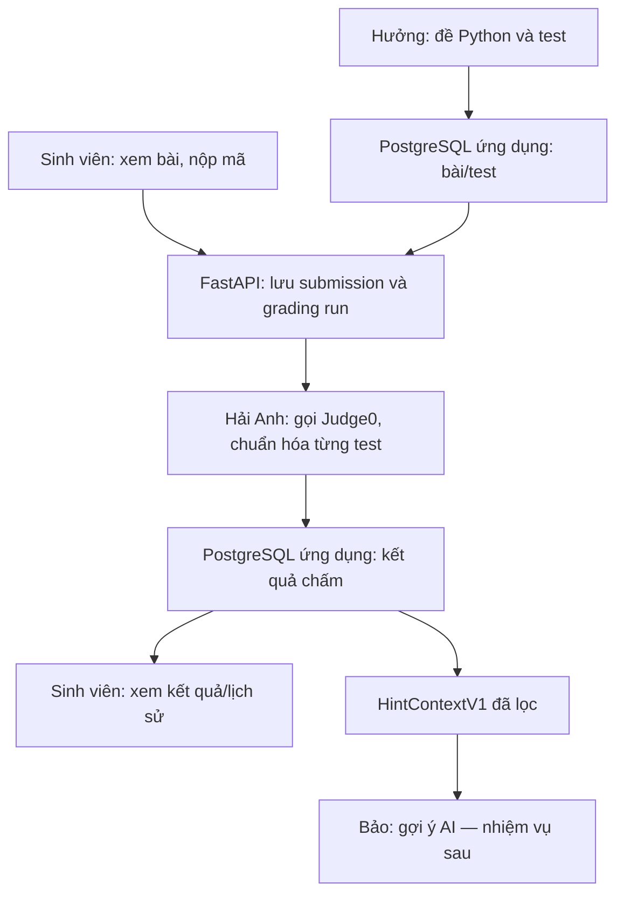

# Giao việc cho Codex trong VS Code — phần Hưởng và Hải Anh

> **Nhiệm vụ:** Kiểm tra repository hiện tại rồi triển khai phần Hưởng và Hải Anh thành ứng dụng chạy được: chuẩn bị **20 bài Python**, chạy test mã sinh viên qua Judge0, lưu kết quả trong PostgreSQL, cho sinh viên xem bài/kết quả/lịch sử và tạo `HintContextV1` làm đầu vào cho phần gợi ý của Bảo. **Dừng ở ranh giới đó:** không gọi mô hình AI, không sinh KM/KH, không trừ quota trong nhiệm vụ này. Không dừng ở việc viết tài liệu hoặc tạo dữ liệu `passed/failed` giả.

## 1. Hiểu đúng hệ thống và phạm vi của hai người

Toàn hệ thống cuối cùng có hai đường: **chấm bài** và **gợi ý theo yêu cầu**. Hưởng và Hải Anh làm đường thứ nhất cùng điểm giao dữ liệu cho đường thứ hai. Bảo sẽ làm AI, checker và việc phát gợi ý sau. Một bài nộp sai **không tự động** sinh gợi ý; về sau sinh viên phải chủ động bấm yêu cầu.



Quyết định đã chốt: FastAPI/Python; PostgreSQL ứng dụng **riêng** với CSDL nội bộ Judge0; Judge0 được gọi qua API; chỉ tập trung tính đúng/sai theo test, chưa phân tích độ phức tạp thuật toán/bộ nhớ. Về sau tối đa 3 gợi ý **lưu thành công** cho mỗi sinh viên/bài; lượt đầu KM, hai lượt tiếp KH; cooldown 120 giây từ lúc lưu thành công; nộp lại không reset; AI/checker thất bại hoặc xem lại không trừ; một yêu cầu gợi ý đang xử lý cho mỗi cặp sinh viên/bài; bài đạt hết test không nhận gợi ý sửa lỗi; lỗi hạ tầng không được gọi là lỗi mã sinh viên. **Các quy tắc gợi ý chỉ để thiết kế điểm nối, không triển khai ở file giao việc này.** Không đặt quota lên `submission`; khi Bảo nối vào, khóa là `(student_id, problem_id)`.

Một `test_case` chỉ gồm **đầu vào và kết quả mong đợi**. Nó không có nhãn “đúng/sai” cố định. Sau khi chạy *một mã sinh viên cụ thể*, tạo `test_result` đạt/trượt cho ca đó. Cùng một test có thể đạt với bài nộp A và trượt với bài nộp B. Judge0 thực thi mã; FastAPI/bộ chấm của nhóm quyết định `passed` hay `wrong_answer` theo hợp đồng của đề.

## 2. Phân công và sản phẩm cụ thể

| Đầu mối | Công việc cần làm | Đầu ra có thể nghiệm thu |
| --- | --- | --- |
| **Hưởng** | Chuẩn 20 đề tiếng Việt, chữ ký hàm, miền đầu vào/đầu ra, ví dụ, test công khai/ẩn, kết quả mong đợi; viết lời giải tham chiếu và mã sai mẫu; kiểm tra seed/ERD; lập ma trận test nghiệm thu và rubric dự kiến cho phần gợi ý | 20 bài có thể seed, test có lý do rõ, lời giải tham chiếu đạt hết, mã sai mẫu bị phát hiện; có tài liệu quy tắc dữ liệu và các trường hợp biên |
| **Hải Anh** | API nộp/xem kết quả, client Judge0, harness gọi hàm, chuẩn hóa trạng thái thực thi, so sánh kết quả, lưu `submission`/`grading_run`/`test_result`, lọc test ẩn, chọn bằng chứng và dựng `HintContextV1` | Một bài đúng/sai chạy end-to-end, 20 bài đều chấm được, có log và kết quả truy vấn được từ PostgreSQL; lỗi hạ tầng không thành `wrong_answer` |
| **Ghép chung** | Thống nhất định dạng bài/test, migrations, API/giao diện tối thiểu, thử mã đúng/mã sai của Hưởng trên bộ chấm của Hải Anh | Demo xem bài → nộp Python → xem kết quả từng test được phép hiện → xem lịch sử; xuất context hợp lệ cho Bảo |

Chủ sở hữu cuối cùng của toàn bộ frontend, migrations và tích hợp FastAPI chưa được nhóm chốt. **Để PoC chạy được**, Codex phải viết phần mã liên kết cần thiết, đồng thời ghi rõ module nào cần nhóm nhận bàn giao. Không gán AI của Bảo cho hai người này.

## 3. Cách Codex bắt đầu và thứ tự triển khai

1. Kiểm tra repo, README, cấu trúc, framework, `AGENTS.md`, dữ liệu và dịch vụ đã có. Sửa tiếp ứng dụng hiện có; không tạo dự án thứ hai. Nếu repo trống, khởi tạo FastAPI, PostgreSQL, migration, seed, tests và giao diện tối thiểu.
2. Chốt một định dạng bài: mặc định sinh viên viết **một hàm Python** có tên/chữ ký rõ, các đối số và giá trị trả về biểu diễn được bằng JSON; không dùng `input()`/`print()` làm hợp đồng trả lời. Nếu repo đã có quy ước khác tốt hơn, ghi lại lý do và dùng nhất quán. Cùng Hưởng hoàn thiện **1–2 bài đầu**, chạy thật end-to-end rồi mới làm đủ 20 bài.
3. Kiểm tra API của **instance Judge0 đang cấu hình**. Đọc docs chính thức, xác định Python language ID thực tế, tạo submission nhận token rồi polling có timeout/backoff; đừng giả định `wait=true` luôn bật. Ghi nhận lỗi HTTP, network, status, stdout/stderr/compile_output/message; giới hạn thời gian và output.
4. Sau khi 1–2 bài chạy đúng, mở rộng 20 bài, seed idempotent, chấm tất cả lời giải tham chiếu và mã sai mẫu; hoàn thiện lịch sử, lọc test ẩn và `HintContextV1`.
5. Ghi quyết định chưa chốt và mặc định PoC trong `docs/open-decisions.md`, kết quả đã **thực chạy** trong `docs/verification.md`. Không tự ghi log/điểm số tưởng tượng.

## 4. Hưởng — nội dung của 20 bài Python

Mỗi bài cần: `slug`, version, tiêu đề, mô tả tiếng Việt, tên/chữ ký hàm, miền đầu vào/đầu ra, quy tắc với đầu vào biên, ví dụ công khai, test có `test_index`/`args`/`expected`/`is_public`/`purpose`, lời giải tham chiếu nội bộ và ít nhất một mã sai mẫu. Có thể soạn khoảng **8 test/bài hoặc hơn khi cần**; đây là mục tiêu đề xuất, không phải con số đã được nhóm chốt. Chọn test có mục đích thay vì lặp để đủ số.

| Mã | Bài đề xuất | Chữ ký | Ca cần nghĩ đến |
| --- | --- | --- | --- |
| P01 | Tính tổng danh sách | `sum_numbers(numbers)` | Rỗng, một số, số âm |
| P02 | Đếm số chẵn | `count_even(numbers)` | 0, âm chẵn, không có số chẵn |
| P03 | Tìm giá trị lớn nhất | `find_max(numbers)` | Số âm, trùng; quy định rỗng |
| P04 | Đảo chuỗi | `reverse_text(text)` | Rỗng, Unicode |
| P05 | Kiểm tra đối xứng | `is_palindrome(text)` | Lẻ/chẵn; quy định hoa–thường |
| P06 | Giai thừa | `factorial(n)` | 0, 1; miền n không âm |
| P07 | Fibonacci thứ n | `fibonacci(n)` | 0, 1, n nhỏ |
| P08 | Kiểm tra số nguyên tố | `is_prime(n)` | n<2, 2, số chính phương |
| P09 | Ước chung lớn nhất | `gcd(a, b)` | Có số 0; quy định số âm |
| P10 | Xóa trùng giữ thứ tự | `unique_in_order(items)` | Rỗng, trùng rải rác |
| P11 | Số lớn thứ hai phân biệt | `second_largest(numbers)` | Trùng max, không đủ phần tử |
| P12 | Gộp hai danh sách đã sắp | `merge_sorted(left, right)` | Một bên rỗng, giá trị trùng |
| P13 | Vị trí xuất hiện đầu | `first_index(items, target)` | Không thấy, lặp, đầu/cuối |
| P14 | Đếm tần suất ký tự | `char_counts(text)` | Rỗng, dấu cách, Unicode |
| P15 | Tổng chữ số | `digit_sum(n)` | 0; quy định n âm |
| P16 | Chuẩn hóa khoảng trắng | `normalize_spaces(text)` | Đầu/cuối, nhiều khoảng trắng |
| P17 | Giao hai danh sách không trùng | `intersection(left, right)` | Quy tắc thứ tự, trùng |
| P18 | Tổng đường chéo ma trận vuông | `diagonal_sum(matrix)` | 1×1, số âm |
| P19 | Đếm từ trong câu | `word_count(text)` | Rỗng, nhiều khoảng trắng |
| P20 | Ngoặc cân bằng | `balanced_brackets(text)` | Lồng nhau, sai thứ tự |

Danh sách là **đề xuất**, chưa phải dữ liệu bài đã được viết. Với P03/P11/P17 và các bài có nhiều cách hiểu, Hưởng phải chốt rõ hành vi trước khi viết test. Seed phải nạp lại không trùng, có version và khóa unique; lời giải tham chiếu/test ẩn không được trả ở API sinh viên. Hưởng tạo mã sai có chủ đích như `return` quá sớm, thiếu xử lý rỗng, sai biên; ghi **test nào dự kiến trượt** rồi đối chiếu với kết quả Judge0.

Định dạng minh họa:

```json
{
  "slug": "p01-sum-numbers",
  "version": 1,
  "title": "Tính tổng danh sách",
  "function_name": "sum_numbers",
  "function_signature": "sum_numbers(numbers)",
  "statement": "Trả về tổng các số nguyên; danh sách rỗng trả về 0.",
  "tests": [
    {"test_index": 1, "args": [[2, 3, 4]], "expected": 9, "is_public": true, "purpose": "Thông thường"},
    {"test_index": 2, "args": [[]], "expected": 0, "is_public": false, "purpose": "Danh sách rỗng"}
  ]
}
```

Nếu tham khảo [MBPP](https://github.com/google-research/google-research/tree/master/mbpp), ưu tiên bộ đã rà [`sanitized-mbpp.json`](https://github.com/google-research/google-research/blob/master/mbpp/sanitized-mbpp.json), nhưng **chọn, đọc, biên soạn và xác minh thủ công**. Dữ liệu này là mảng JSON có prompt/code/test dạng `assert` Python, không phải bảng `args/expected` có sẵn; không `eval`/`exec` dữ liệu bài để nhập test, không đưa lời giải vào API/prompt sau này. Ghi `source_task_id` nếu thật sự dùng, test nào bổ sung, và kiểm tra quyền sử dụng/ghi công. Bài tự soạn thì ghi là tự soạn.

## 5. Hải Anh — bộ chấm và Judge0

Mặc định PoC: chạy **một tác vụ Judge0 cho mỗi test** với runner do server tạo để gọi hàm sinh viên. Thu giá trị trả về ở định dạng kiểm soát được, tách `print()` của sinh viên; **so sánh với `expected` ở ứng dụng**, không dựa duy nhất vào status `Accepted` của Judge0. Không gửi expected vào mã sinh viên khi có thể tránh. Nếu chọn multi-file/một tác vụ cho cả bài, phải chứng minh trên instance đang dùng rằng parser biết đủ test và lỗi giữa chừng không thành “đạt hết”. Giới hạn mã/đầu ra/thời gian. Test mã gọi `sys.exit()` hoặc in marker/JSON giả; không tuyên bố đã chống được mọi mã đối kháng.

| Kết quả chuẩn hóa | Diễn giải |
| --- | --- |
| `passed` | Đã chạy và giá trị trả về đúng theo hợp đồng so sánh |
| `wrong_answer` | Đã chạy nhưng giá trị khác mong đợi |
| `syntax_error`, `runtime_error` | Mã sinh viên lỗi cú pháp hoặc khi chạy |
| `time_limit_exceeded` | Mã sinh viên vượt giới hạn theo bộ chấm |
| `infrastructure_error` | Judge0, mạng hoặc runner lỗi; **không** kết luận sinh viên sai |
| `incomplete` | Thiếu kết quả tin cậy; không được đánh dấu đạt hết |

`grading_run` chuyển `queued → running → completed` hoặc `technical_error`. Lỗi cú pháp/runtime là **lỗi mã sinh viên được chấm hợp lệ** nếu phân loại tin cậy; lỗi Judge0/network/harness là lỗi kỹ thuật. Bài có 0 test không được xuất bản/chấm đạt. `all_passed=true` chỉ khi số test > 0, đủ kết quả hợp lệ và tất cả đều `passed`. Gọi lại worker/API không tạo test_result trùng, kết quả đến muộn không ghi đè một lượt chấm đã kết thúc. Không giữ giao dịch DB suốt khi chờ Judge0.

## 6. PostgreSQL, API, giao diện và bảo vệ test ẩn

Tạo migrations thật, FK/unique/check phù hợp. Ít nhất các nhóm dữ liệu:

| Bảng | Trường/quan hệ chính |
| --- | --- |
| `student` | id, định danh đăng nhập hoặc cơ chế demo được đánh dấu rõ |
| `problem` | id, slug unique, title, statement, function_signature, version, trạng thái công bố |
| `test_case` | id, problem_id, test_index, args JSON, expected JSON, is_public, test_version; unique `(problem_id, test_version, test_index)` |
| `submission` | id, student_id, problem_id, source_code snapshot, submitted_at |
| `grading_run` | id, submission_id, status, all_passed, expected_test_count, test_version, timestamps, technical_error_code |
| `test_result` | id, grading_run_id, test_case_id, status, actual JSON, error_summary, judge0_token; unique `(grading_run_id, test_case_id)` |

Giữ snapshot/version test đủ để giải thích kết quả cũ khi test được sửa. Không lưu quota theo submission. **Không dùng CSDL nội bộ Judge0** cho bảng ứng dụng.

API tối thiểu: danh sách bài; chi tiết bài chỉ gồm ví dụ công khai; nộp mã; xem trạng thái/lượt chấm; lịch sử nộp của chính sinh viên. Nếu repo có auth thì giữ và kiểm tra quyền sở hữu. Nếu chưa có, chế độ demo ID cố định **chỉ cho môi trường phát triển**, không coi việc client gửi `student_id` là xác thực. Giao diện tối thiểu: danh sách 20 bài, trang đề, ô nhập mã, nút Nộp, trạng thái đang chấm, số test đạt/tổng, lỗi được phép hiện và lịch sử. **Không tạo nút gợi ý AI giả.**

Test ẩn: serializer sinh viên **không trả** input/expected/actual và stdout/stderr nguyên dạng của test ẩn, kể cả UI không hiển thị. Bằng chứng công khai có thể hiện chi tiết theo chính sách; test ẩn chỉ góp phần vào tổng quan được phép công bố. Kiểm tra JSON response thực tế, không chỉ ảnh giao diện. Lời giải tham chiếu và seed nội bộ không có API công khai.

## 7. Điểm giao cho Bảo: `HintContextV1`

Định nghĩa schema có version và service nội bộ `build_hint_context(student_id, submission_id, grading_run_id)`. Chỉ nhận run thuộc đúng bài nộp/chủ sở hữu, đã chấm hợp lệ và `all_passed=false`; lỗi kỹ thuật, run đang xử lý hoặc bài đạt hết không sinh context sửa lỗi. Gắn đúng version bài/test, mã đã nộp, loại lỗi, số test đạt/trượt và tối đa **K=2** bằng chứng lỗi công khai được chọn ổn định theo `test_index`. K=2 là **mặc định đề xuất chưa chốt**. Không đưa lời giải tham chiếu hay input/expected/actual test ẩn. Nếu chỉ trượt test ẩn, trả tổng quan lỗi đã lược chi tiết theo chính sách, không bịa test công khai sai.

```json
{
  "schema_version": "1",
  "problem_id": 1,
  "problem_version": 1,
  "submission_id": 17,
  "grading_run_id": 24,
  "test_version": 1,
  "problem": {"statement": "Tính tổng danh sách số nguyên.", "function_signature": "sum_numbers(numbers)"},
  "student_code": "def sum_numbers(numbers):\n    total = 0\n    for x in numbers:\n        total += x\n        return total",
  "grading": {"status": "completed", "all_passed": false, "passed_count": 0, "failed_count": 2},
  "evidence": [
    {"test_index": 1, "failure_type": "wrong_answer", "visibility": "public", "args": [[2, 3, 4]], "expected": 9, "actual": 2}
  ]
}
```

Ví dụ này là fixture minh họa, không phải log chạy thật. Bảo sẽ nhận context khi sinh viên **yêu cầu gợi ý trong giai đoạn sau**, không phải vì Hải Anh vừa chấm xong. `HintContextV1` **không có nội dung KM/KH, không trừ quota và không tự gọi AI**. Document schema và ví dụ lỗi (`not_owner`, `grading_pending`, `grading_technical_error`, `all_passed`) cho nhóm tích hợp sau này.

## 8. Kiểm thử và log bắt buộc

- Unit test: so sánh đúng kiểu dữ liệu (`9` khác `"9"`), chuẩn hóa trạng thái, lọc test ẩn, chọn K bằng chứng, thiếu test/0 test.
- API + PostgreSQL: seed hai lần không nhân đôi; nộp mã lưu snapshot; đọc lại kết quả/lịch sử; không xem được bài nộp người khác nếu có auth.
- Mock Judge0: `Accepted` nhưng hàm trả sai, syntax/runtime/TLE, lỗi mạng, HTTP lỗi, phản hồi không hợp lệ, polling timeout; lỗi kỹ thuật không bị biến thành `wrong_answer`.
- Smoke test Judge0 **thật**: một bài đúng, một bài sai nhiều test, một bài mã lỗi; nếu instance chưa có thì ghi rõ chưa chạy, không khai đã kiểm chứng thật.
- Toàn bộ 20 lời giải tham chiếu đạt bộ test; 20 mã sai mẫu trượt ít nhất một test; đối chiếu dự kiến của các lỗi tiêu biểu.
- API sinh viên không lộ test ẩn; `HintContextV1` không có lời giải/test ẩn, không sinh từ bài đạt hết hoặc lỗi hạ tầng; `print()` JSON giả và `sys.exit()` không thể tự tạo kết luận đạt toàn bài.

Log có `request_id`, `submission_id`, `grading_run_id`, `problem_id`, `test_index`, trạng thái, thời gian và Judge0 token; che khóa API, lời giải, mã/đầu vào test ẩn trong log chia sẻ. Tạo `docs/verification.md` gồm lệnh đã chạy, số bài/test seed, bảng kết quả **thực đo**, ví dụ log đã lược dữ liệu và những kiểm chứng chưa thực hiện.

## 9. Điều kiện hoàn thành và bàn giao

1. Một bài chạy trọn luồng FastAPI → Judge0 → PostgreSQL → kết quả giao diện; có một mã đúng và một mã sai.
2. Chấm đúng các trường hợp lỗi, không coi 0 test/thiếu test là đạt, lỗi hạ tầng tách riêng, API không lộ test ẩn.
3. Seed đủ **20 bài hoàn chỉnh** với test, lời giải tham chiếu, mã sai mẫu; chạy bộ nghiệm thu của Hưởng.
4. `HintContextV1` có schema, ví dụ, test và cách gọi nội bộ để Bảo nối vào. **Không lấy việc chỉ xuất JSON này làm bằng chứng hệ thống gợi ý đã hoàn thành.**
5. Có README, `.env.example`, migrations, hướng chạy trong VS Code, OpenAPI, giao diện, test tự động, `docs/verification.md` và `docs/open-decisions.md`.

Khi kết thúc, Codex báo file đã tạo/sửa, lệnh chạy/seed/test, log thật, phần phụ thuộc dịch vụ ngoài chưa chạy được và vấn đề cần nhóm chốt. Không tự chuyển sang làm AI/quota của Bảo khi chưa được giao ở một nhiệm vụ khác.

## 10. Các quyết định vẫn mở

1. Chủ sở hữu cuối của frontend/migrations/tích hợp API.
2. Chỉ dùng bài kiểu hàm JSON hay hỗ trợ stdin/stdout.
3. Số lượng test công khai/ẩn và thông tin tổng quan cho test ẩn.
4. K=2 bằng chứng cho Bảo; trường hợp chỉ trượt test ẩn.
5. Cách xác thực sinh viên trong ứng dụng thật.
6. Judge0 deployment, timeout, giới hạn chạy và polling cụ thể.
7. Quy tắc so sánh số thực, `None`, thứ tự và đầu ra đặc biệt.
8. Version đề/test, lưu lịch sử và việc chấm lại khi sửa test.

**Nguồn tham khảo đã đối chiếu:** [AI_Tutor](https://github.com/sheheenmtp/AI_Tutor) để xem ứng dụng gần ý tưởng (không sao chép cách gộp lỗi hạ tầng vào test sai); [Online-Judge-platform](https://github.com/everlastingQAQ/Online-Judge-platform) cho kiến trúc Judge0/service/tests (không sao chép việc trả input/expected test trong API chi tiết); [CodeRunner](https://github.com/trampgeek/moodle-qtype_coderunner) cho cách biên soạn test công khai/ẩn; [MBPP](https://github.com/google-research/google-research/tree/master/mbpp) cho ý tưởng bài; [Judge0 API](https://github.com/judge0/judge0/tree/master/docs/api) cho hợp đồng thực thi. Kiểm tra license trước khi tái sử dụng mã/dữ liệu từ repo khác.
